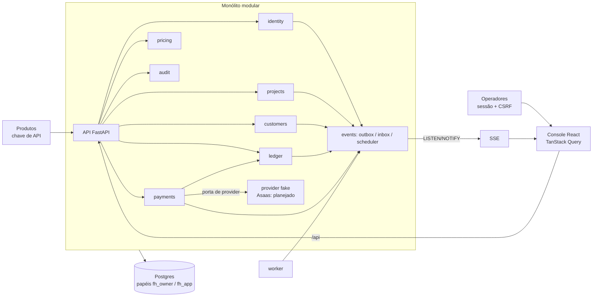

# Financial Hub

[](https://github.com/LucasGRPiovesan/financial-hub/actions/workflows/ci.yml)
[](https://github.com/LucasGRPiovesan/financial-hub/actions/workflows/e2e.yml)

O Financial Hub é o sistema de registro financeiro (*system of record*) de N produtos integrados: os produtos enviam
fatos de negócio (consumo, compras, consultas) e o Hub os transforma, de forma determinística e auditável, em
movimentações de dinheiro ancoradas em um razão contábil de partidas dobradas. É multi-provider por desenho: o
domínio fala com uma porta de provider, e o Asaas Sandbox é o único provider real planejado (nunca credenciais de
produção). IA entra apenas no onboarding de integrações; ela nunca movimenta dinheiro nem ativa configuração sem
aprovação humana ([ADR-0009](docs/adr/0009-ai-and-mcp-boundary.md)).

Projeto de portfólio. A seção [Status](#status) diz com precisão o que existe no código hoje e o que ainda é plano.

## Para avaliadores

**Leia primeiro (cerca de 10 minutos):**

1. **Razão contábil** com invariantes impostos pelo banco (triggers, `ledger_apply`, papéis `fh_owner`/`fh_app`):
   [ADR-0003](docs/adr/0003-double-entry-ledger.md), [`0001_ledger_core.py`](backend/migrations/versions/0001_ledger_core.py),
   receitas de lançamento em [`ledger/domain/recipes.py`](backend/src/financial_hub/modules/ledger/domain/recipes.py).
2. **Pagamentos: estado ortogonal e protocolo de chamadas externas com fencing token** (`attempt_id`, CAS, resultado
   desconhecido resolvido por consulta): [ADR-0012](docs/adr/0012-payment-state-and-external-calls.md),
   [`payments/domain/state.py`](backend/src/financial_hub/modules/payments/domain/state.py),
   [`payments/application/service.py`](backend/src/financial_hub/modules/payments/application/service.py).
3. **Idempotência**: [ADR-0004](docs/adr/0004-idempotency.md) e [`0006_idempotency_rate_limits.py`](backend/migrations/versions/0006_idempotency_rate_limits.py).
4. **RBAC, chaves de API com escopos e segredos criptografados**: [docs/SECURITY.md](docs/SECURITY.md).
5. **Fronteiras de módulo verificadas por máquina**: contratos do `import-linter` em [`backend/pyproject.toml`](backend/pyproject.toml).

**Rodar em 5 minutos** (só precisa de Docker; detalhes em [Como rodar](#como-rodar)):

```bash
cp .env.example .env && docker compose up -d --build --wait api web
docker compose run --rm api python -m financial_hub.cli seed-demo
# abra http://localhost:5173 e escolha um operador demo (ex.: Ana Owner)
```

## Status

Derivado do código e do histórico git (não do plano). Itens "Planejado" estão arquiteturados em ADRs/docs, sem implementação.

| Capacidade | Status | Observação |
|---|---|---|
| Razão de partidas dobradas, holds, estornos, balancete; invariantes no banco | Implementado | Receitas R1-R13, APIs de leitura, testes de propriedade |
| Dinheiro em unidades mínimas inteiras, TypeIDs | Implementado | `shared/money.py`, `shared/ids.py` |
| Motor de precificação (funções puras) | Implementado | Testado, incluindo propriedades (`tests/property/pricing`) |
| Log de eventos / outbox, dispatcher, inbox, scheduler, explorador de eventos | Implementado | Somente Postgres |
| Tempo real (SSE + `LISTEN/NOTIFY`) | Implementado | Hook `useProjectStream` no console |
| Identidade: operadores, sessões, CSRF, throttling, RBAC (owner/admin/finance/viewer) | Implementado | Login demo opt-in para avaliação |
| Projetos, membros, chaves de API com escopos | Implementado | Hash HMAC com pepper, exibição única |
| Contas de provider com credenciais criptografadas (AES-256-GCM) | Implementado | Catálogo e contas; sem adapter real |
| Log de auditoria append-only, `Idempotency-Key`, rate limit em Postgres | Implementado | |
| Clientes universais e identidades por projeto | Implementado | Documento (CPF/CNPJ) em cofre criptografado |
| Pagamentos: estado ortogonal, porta de provider, chamadas externas com fencing, reembolsos | Implementado | **Com provider fake** (`fake_provider.py`) |
| Pagamentos lançam no razão (captura, ajuste de taxa, liquidação, reembolso) na mesma transação | Implementado | Receitas R1-R4, R2a, R2b, R8; [`ledger_postings.py`](backend/src/financial_hub/modules/payments/application/ledger_postings.py) |
| Console React (visão geral, projetos, chaves, membros, clientes, integrações) | Implementado | Design em [docs/FRONTEND.md](docs/FRONTEND.md) |
| Suíte E2E Playwright como usuário final | Implementado | Roda em CI na `main` |
| Adapter Asaas Sandbox, webhooks de entrada, sweeper de resultado desconhecido | Planejado | Protocolo já definido no ADR-0012 |
| Medição de uso (metering), cobrança, faturas, assinaturas, carteira | Planejado | Módulos ainda vazios; ADR-0007 |
| Webhooks de saída, reconciliação, manifesto de integração | Planejado | ADR-0008, ADR-0013 |
| Onboarding com IA e servidor MCP | Planejado | ADR-0009; a IA nunca movimenta dinheiro |
| Stripe / Mercado Pago, FX multi-moeda | Planejado | A porta de provider já comporta novos adapters |

## Arquitetura

Monólito modular (FastAPI + SQLAlchemy + Postgres 18) com camadas `api / application / domain / infrastructure` por
módulo, console em React e eventos via outbox transacional.



- Fronteiras impostas por `import-linter`: **17 contratos, todos mantidos** (`bash scripts/imports.sh`). Entre outros:
  `shared` não depende de nada interno; `domain` só depende de `shared`; módulos nunca importam o
  `domain`/`infrastructure`/`api` uns dos outros (só via `application.api`); só adapters de provider alcançam o cofre de
  credenciais e a decriptação; `payments` nunca alcança o cofre.
- O runtime nunca usa credenciais de dono: `api` e `worker` conectam como `fh_app` (sem DDL, sem `UPDATE`/`DELETE`
  em lançamentos).
- Detalhes: [docs/ARCHITECTURE.md](docs/ARCHITECTURE.md), [docs/DOMAIN.md](docs/DOMAIN.md), [docs/FINANCIAL_MODEL.md](docs/FINANCIAL_MODEL.md).

## Decisões de engenharia

Todas as decisões estão em [docs/adr/](docs/adr/) (13 ADRs, resumo em [docs/DECISIONS.md](docs/DECISIONS.md)).

- **Unidades mínimas inteiras, sem `float`**: valores monetários são inteiros com regras de arredondamento explícitas. [ADR-0002](docs/adr/0002-money-representation.md)
- **Razão imutável de partidas dobradas**: lançamentos só são acrescentados; saldos mudam apenas via `ledger_apply`;
  o papel de runtime não tem `UPDATE`/`DELETE` nem DDL. [ADR-0003](docs/adr/0003-double-entry-ledger.md)
- **Chaves de idempotência**: `Idempotency-Key` na API e chaves derivadas do fato nos lançamentos. [ADR-0004](docs/adr/0004-idempotency.md)
- **Outbox / inbox em Postgres**: o log de eventos é a outbox transacional; sem broker externo. [ADR-0005](docs/adr/0005-event-log-outbox.md)
- **Estado de pagamento ortogonal + fencing tokens**: dimensões independentes (criação, captura, reembolso) e `attempt_id`
  com CAS, para que retries e leases expirados nunca dupliquem dinheiro. [ADR-0012](docs/adr/0012-payment-state-and-external-calls.md)
- **TypeIDs** (`<prefixo>_<UUIDv7 em base32>`), erros RFC 9457 e paginação por cursor. [ADR-0001](docs/adr/0001-ids-errors-pagination.md)
- **Credenciais de provider criptografadas** (AES-256-GCM, chaves versionadas, dados associados ao projeto/conta);
  a decriptação só é importável pela camada de provider (contrato do import-linter). [docs/SECURITY.md](docs/SECURITY.md)
- **Papéis e grants de banco** (`fh_owner` vs `fh_app`, grants por coluna, triggers de integridade). **Não há Row-Level
  Security**: o isolamento entre projetos é feito na aplicação (`404` indistinguível para outro projeto) e coberto por
  testes. [ADR-0011](docs/adr/0011-tenancy-isolation.md)
- **Escopos de chave de API de menor privilégio**: `payments:refund` é separado de `payments:write`; chaves nunca
  recebem permissões administrativas. [docs/SECURITY.md](docs/SECURITY.md)
- **Provider-agnóstico**: o domínio depende de uma porta, o Asaas é só um adapter. [ADR-0006](docs/adr/0006-payment-provider-abstraction.md)

## Como rodar

Só é preciso Docker (e `bash` para os scripts); o host não precisa de Python nem Node. Referência completa:
[docs/DEVELOPMENT.md](docs/DEVELOPMENT.md).

```bash
cp .env.example .env            # sem segredos reais; .env está no .gitignore
docker compose up -d --build    # db, migrate (alembic upgrade head), api, worker, web
docker compose ps               # migrate termina com código 0; demais saudáveis
docker compose run --rm api python -m financial_hub.cli seed-demo   # idempotente
```

| Serviço | URL |
|---|---|
| API (docs OpenAPI) | http://localhost:8000/docs (`/health/live`, `/health/ready`) |
| Console web | http://localhost:5173 |

O login demo (`FH_DEMO_LOGIN=true`) já vem ligado para o serviço `api` em `deploy/compose.yaml`; fica desligado em
qualquer outro lugar e **nunca** deve ser ativado em produção. `seed-demo` cria o projeto "Demo Store" com quatro
personas, escolhidas na tela de login: **Ana Owner** (owner), **Bruno Admin** (admin), **Carla Finance** (finance) e
**Diego Viewer** (viewer), por exemplo `ana@demo.financial-hub.local`. Para criar um operador real:
`docker compose run --rm api python -m financial_hub.cli create-operator --email ... --display-name ...`
(a senha é pedida de forma interativa; não existe flag `--password`).

**Gates de qualidade** (todos em Docker, a partir da raiz):

```bash
bash scripts/lint.sh && bash scripts/typecheck.sh && bash scripts/imports.sh   # backend: ruff, pyright strict, import-linter
bash scripts/test.sh                  # pytest (unit + integração), banco próprio financial_hub_test
bash scripts/web-lint.sh && bash scripts/web-typecheck.sh && bash scripts/web-test.sh && bash scripts/web-build.sh
bash scripts/e2e.sh                   # Playwright em stack Compose dedicada
bash scripts/check.sh                 # tudo, exceto e2e
bash scripts/web-api.sh               # regenera openapi.json e o cliente orval (CI falha se houver diff)
```

Encerrar: `docker compose down` (com `-v` apaga também o banco de dados).

## Qualidade

- **Camadas de teste**: unidade, integração (Postgres real, papel `fh_app` de runtime), propriedades (Hypothesis, para
  dinheiro, razão e precificação) e contrato; no frontend, Vitest + Testing Library; ponta a ponta com Playwright
  atuando como as personas demo ([docs/TESTING.md](docs/TESTING.md)).
- **Cobertura**: medida com `pytest-cov` (com *branch coverage*) a cada execução e publicada como artefato do CI;
  ainda não há um limite mínimo imposto (`fail_under`).
- **CI** ([`ci.yml`](.github/workflows/ci.yml)): `backend` (ruff, pyright strict, import-linter, pytest), `frontend`
  (eslint, tsc, vitest, build, cliente de API atualizado) e `security`. [`e2e.yml`](.github/workflows/e2e.yml) roda o
  Playwright na `main`. Actions fixadas por SHA, `permissions: contents: read`.
- **Segurança na pipeline**: gitleaks no histórico completo, `pip-audit`, `npm audit` e Trivy nas imagens de runtime.
  O modelo de ameaças e os controles estão em [docs/SECURITY.md](docs/SECURITY.md) (o STRIDE completo ainda é pendência).

## Estrutura do repositório

```text
backend/    FastAPI + SQLAlchemy; src/financial_hub/{shared,platform,modules,workers,cli}, migrations/ (0001-0009), tests/
frontend/   Console React 19 + TypeScript strict; cliente de API gerado (orval) a partir de openapi.json
e2e/        Suíte Playwright (jornadas das personas demo)
deploy/     compose.yaml (stack de dev), compose.e2e.yaml
scripts/    Wrappers Docker: lint, typecheck, imports, test, web-*, e2e, check
docs/       PLAN, ARCHITECTURE, DOMAIN, FINANCIAL_MODEL, SECURITY, TESTING, FRONTEND, INTEGRATIONS, adr/
```

## Roadmap

O plano mestre, o escopo (Implementado / Sandbox / Simulado / Planejado) e os marcos estão em [docs/PLAN.md](docs/PLAN.md).
Próximos passos: adapter Asaas Sandbox e webhooks de entrada sobre a porta de pagamentos existente, medição de uso e
cobrança, webhooks de saída, reconciliação e onboarding assistido por IA.

## Licença

Este repositório ainda não define uma licença (não há arquivo `LICENSE`); todos os direitos reservados ao autor.
